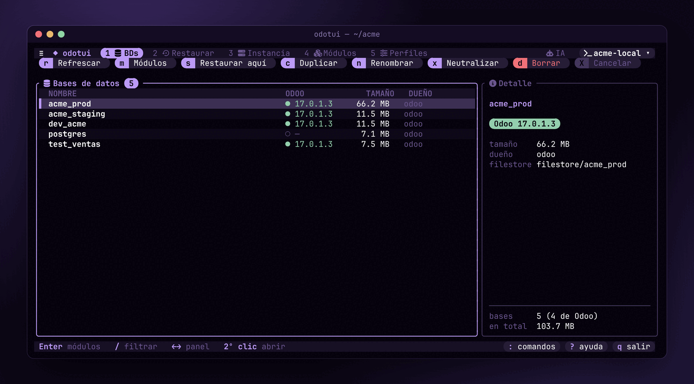
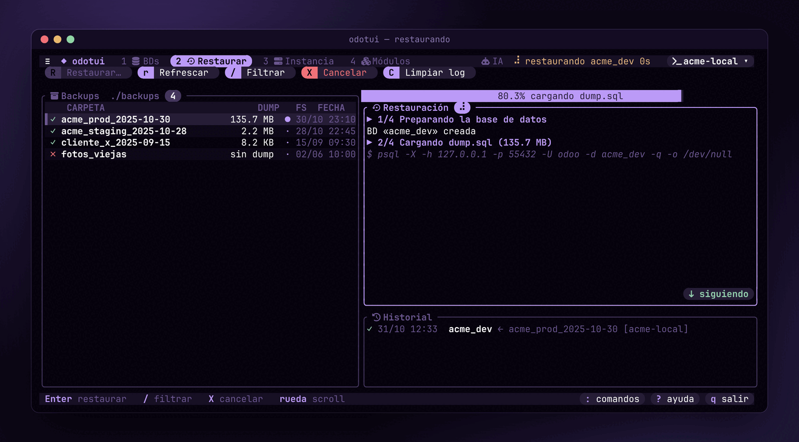
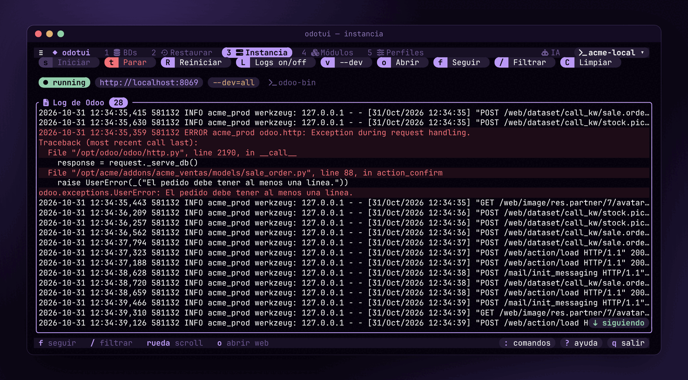
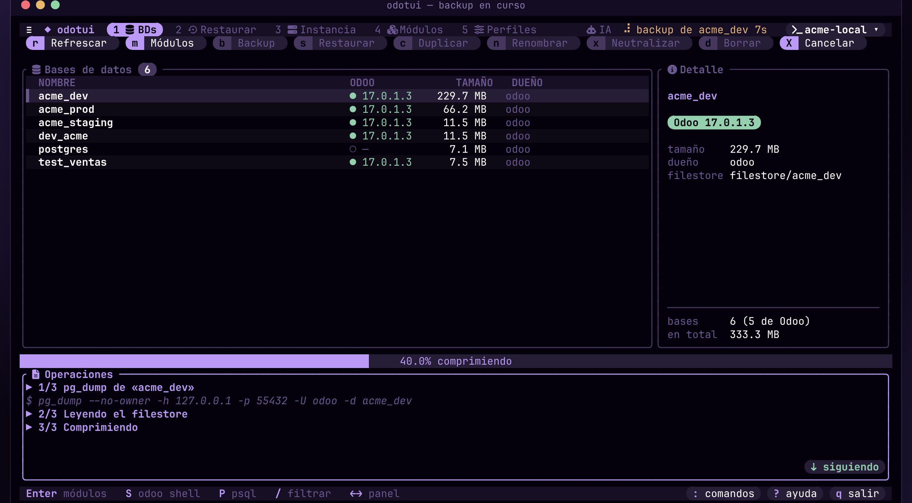
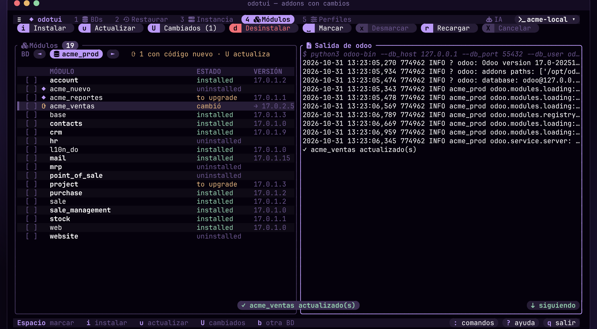
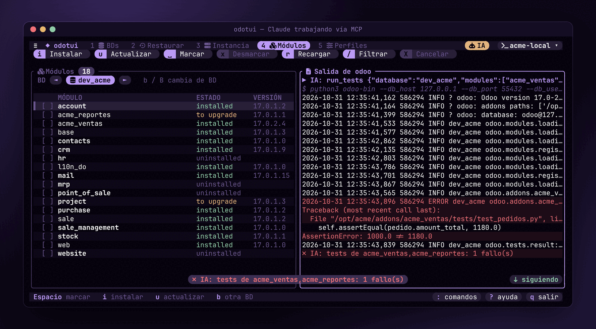
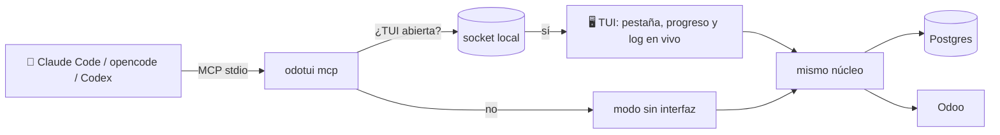

<div align="center">

# ◆ odotui

**Tu entorno de desarrollo Odoo en la terminal.**<br>
Bases de datos, backups, servidor y módulos: con el mouse, con el teclado o con una IA.

[](https://www.rust-lang.org)
[](https://ratatui.rs)
[](https://modelcontextprotocol.io)
[](https://www.odoo.com)
[](#-instalación)



</div>

## ✨ Qué hace

| | |
|---|---|
| 🗄️ **Bases de datos** | Lista con tamaño, dueño y versión de Odoo. Duplica, renombra, neutraliza y borra, siempre junto con su filestore. |
| 💾 **Backups** | Crea `.zip` compatibles con el gestor de Odoo (con filestore y `manifest.json`) o `.dump`, y restaura esos, los de **Odoo.sh**, `.sql`, `.sql.gz` y carpetas `dump.sql`. **Progreso real**, se puede cancelar y neutraliza la copia (sin crons, sin correo, `admin/admin`). |
| 🖥️ **Instancia** | Inicia, para y reinicia Odoo (contenedor o `odoo-bin`) con el **log en vivo**: colores por nivel, tracebacks resaltados y filtro. |
| 🧩 **Módulos** | Instala (`-i`), actualiza (`-u`) o desinstala viendo la salida de Odoo. Marca con **⟳** tus addons cuyo código cambió y los actualiza de una vez. |
| 🐍 **Shell y psql** | `odoo shell` o `psql` sobre la BD seleccionada, en la misma terminal; al salir vuelves a la TUI. |
| 🩺 **Tracebacks** | Solo errores con `e`, copia el último con `y` o haz clic en una línea roja para copiar su traceback. |
| 🤖 **IA por MCP** | Claude Code, opencode o Codex manejan odotui entero: entienden modelos y vistas, restauran, actualizan, corren tests y leen tracebacks. **Si la TUI está abierta, lo ves en vivo.** |
| 🖱️ **Mouse o teclado** | Todo se puede hacer con clics (pestañas, filas, casillas, botones, rueda) o con teclas. Cada botón muestra su tecla. |
| 🐳 **Docker o local** | Perfiles para `docker compose` o para Odoo desde el código fuente con su Postgres. |
| 🎨 **Sigue tu tema** | En [Omarchy](https://omarchy.org) usa la paleta del sistema y cambia con ella; incluye tokyonight, catppuccin y gruvbox. |

## 📸 Capturas

<table>
  <tr>
    <td width="50%"></td>
    <td width="50%"></td>
  </tr>
  <tr>
    <td align="center"><b>♻️ Restaurar</b>: progreso real del <code>dump.sql</code>, pasos y log</td>
    <td align="center"><b>🖥️ Instancia</b>: log en vivo con los errores y tracebacks en rojo</td>
  </tr>
</table>

<table>
  <tr>
    <td width="50%"></td>
    <td width="50%"></td>
  </tr>
  <tr>
    <td align="center"><b>💾 Backup</b>: zip compatible con Odoo, con su filestore</td>
    <td align="center"><b>🧩 Módulos</b>: <code>⟳</code> el código de <code>acme_ventas</code> cambió; <code>U</code> lo actualiza</td>
  </tr>
</table>

<div align="center">
  
  <p><b>🤖 Una IA trabajando a través de odotui</b>: corrió los tests de <code>acme_ventas</code>; la TUI saltó a Módulos,<br>muestra <code>IA</code> en la cabecera y el fallo con su traceback, el mismo que recibe la IA.</p>
</div>

## 🚀 Instalación

Hay binarios para Linux (gnu y musl) en [Releases](https://github.com/jorge07RD/odotui/releases). Desde el código:

```bash
git clone https://github.com/jorge07RD/odotui.git
cd odotui
cargo install --path . --locked
```

Necesitas `psql` en el `PATH` (y `pg_dump` / `pg_restore` para backups y `.dump`; en docker se usan los del contenedor). Para perfiles docker, además, `docker` sin `sudo` (tu usuario en el grupo `docker`).

> [!TIP]
> Los íconos usan una [Nerd Font](https://www.nerdfonts.com). Si tu terminal no tiene una, pon `icons = false` en la config.

## ⚡ Primeros pasos

```bash
odotui            # sin config, abre el formulario para crear el primer perfil
odotui --init     # o escribe un ejemplo en ~/.config/odotui/config.toml
```

1. Crea un perfil en **5 Perfiles** y pulsa **Probar** (`t`).
2. En **2 Restaurar** elige un backup y pulsa `Enter`.
3. Lánzalo en **3 Instancia** (`s`) y ábrelo en el navegador (`o`).

## 🤖 IA (MCP)

`odotui mcp` es un servidor [MCP](https://modelcontextprotocol.io) por stdio. Regístralo una vez:

```bash
claude mcp add -s user odotui -- odotui mcp
```

En otros clientes, la entrada equivalente es:

```json
{ "mcpServers": { "odotui": { "command": "odotui", "args": ["mcp"] } } }
```



| | Herramienta | Para qué |
|---|---|---|
| 🧭 | `status` | Perfil activo, rutas, estado de Odoo y si la TUI está abierta |
| 🔀 | `switch_profile` · `show` · `cancel` | Cambiar de perfil, mostrar una pestaña, cancelar la tarea en curso |
| 📋 | `list_databases` · `list_backups` · `list_modules` | Inventario |
| 🔎 | `describe_model` · `find_views` · `get_view` · `module_info` · `search_records` | Entender el código: campos y quién los define, vistas y su herencia, el manifest y los datos (ORM), sin escribir SQL |
| 🔍 | `sql_query` | SQL con psql, **de solo lectura** salvo `write=true` |
| 📜 | `read_logs` | Log de Odoo; con `errors_only` devuelve cada error con su traceback y con `since` solo lo nuevo |
| 💾 | `backup_database` · `restore_backup` · `duplicate_database` · `rename_database` · `neutralize_database` · `drop_database` | Lo mismo que las pestañas BDs y Restaurar |
| 🧩 | `install_modules` · `update_modules` · `uninstall_modules` | `-i` / `-u` con `--stop-after-init` o desinstalar por el ORM; devuelven los errores del log |
| 🧪 | `run_tests` | `--test-enable --test-tags`; devuelve el resumen y cada fallo con su traceback |
| 🐍 | `odoo_shell` | Python con `env` del ORM (rollback salvo `env.cr.commit()`) |
| 🏗️ | `scaffold_module` | `odoo scaffold` en `addons_dir` |
| ⏯️ | `instance` | start · stop · restart |

El ciclo típico de la IA es **entender → editar → actualizar → testear**: `describe_model` / `find_views` → editar el módulo → `update_modules` → `run_tests` → `read_logs` con `errors_only`. Restaurar y hacer backups informan su avance (`notifications/progress`) si el cliente lo pide.

> [!NOTE]
> Solo corre una tarea larga a la vez, tuya o de la IA; la otra recibe «ocupado». La TUI y `odotui mcp` se hablan por `$XDG_RUNTIME_DIR/odotui.sock`, con permisos `0600`.

> [!WARNING]
> `drop_database`, `restore_backup` con `overwrite`, `uninstall_modules` y `sql_query` con `write=true` son irreversibles. Las instrucciones del servidor piden a la IA confirmarlo contigo antes.

### 🧠 Skill para Claude Code

[`skills/odotui/`](skills/odotui/SKILL.md) le enseña a la IA a usar odotui: empezar por `status`, el ciclo entender → editar → actualizar → testear, qué operaciones son irreversibles y los problemas ya vistos con Odoo real (login del administrador, licencias, permisos de docker). Incluye la referencia de las 27 herramientas, las teclas de la TUI y `scripts/llamar.py`, para sesiones que no tienen las herramientas MCP cargadas.

```bash
ln -s ~/Projects/odotui/skills/odotui ~/.claude/skills/odotui
```

Con el enlace, el skill se actualiza junto con el repo.

## ⚙️ Perfiles

`~/.config/odotui/config.toml` (ver [`config.example.toml`](config.example.toml)):

```toml
default_profile = "docker-17"

[[profile]]
name = "docker-17"
mode = "docker"
pg_host = "db"                    # host de Postgres visto desde Odoo
pg_user = "odoo"
pg_password = "odoo"
pg_container = "odoo17-db-1"      # psql corre aquí dentro
odoo_container = "odoo17-web-1"
backups_dir = "/home/yo/backups"  # zip, dump, sql(.gz) o <carpeta>/dump.sql, en este equipo
addons_dir = "/mnt/extra-addons"  # para scaffold, ruta en el contenedor
addons_host_dir = "/home/yo/odoo17/addons"  # la misma carpeta en el host: ⟳ addons con cambios

[[profile]]
name = "local-17"
mode = "local"
pg_host = "localhost"
pg_user = "odoo"
odoo_bin = "/home/yo/odoo17/odoo-bin"
python = "/home/yo/odoo17/.venv/bin/python"
odoo_conf = "/home/yo/odoo17/odoo.conf"
backups_dir = "/home/yo/backups"
```

- 🐳 **docker**: `psql` corre dentro de `pg_container`. Odoo se maneja con `docker start/stop/restart`; los módulos, con `docker exec <odoo_container> odoo …`. El filestore se copia con `docker cp` y se le hace `chown odoo:odoo`.
- 💻 **local**: `odoo-bin` corre **en segundo plano**, con su pid y su log en `~/.local/state/odotui/`. Sobrevive a la TUI y la IA ve la misma instancia. Pararlo le manda SIGINT para que cierre limpio.

## 💾 Backups

| Formato | Restaurar | Crear |
|---|---|---|
| `.zip` del gestor de Odoo / Odoo.sh | `dump.sql` leído del zip directo a `psql`; `filestore/` extraído aparte | `b` en BDs: `pg_dump` + filestore + `manifest.json` |
| `.dump` / `.backup` (`pg_dump -Fc`) | `pg_restore --no-owner --no-privileges` | `b` en BDs, formato `dump` (sin filestore) |
| `.sql` · `.sql.gz` | `psql`, descomprimiendo al vuelo | — |
| `<carpeta>/dump.sql` + `filestore/` | `psql` y copia del filestore | — |

Los backups nuevos se llaman `<bd>_<AAAA-MM-DD_HHMM>.zip` y se escriben con un nombre oculto hasta terminar: si fallan o los cancelas no queda nada a medias. Al restaurar un zip, el formulario muestra la versión de Odoo de su manifest y avisa si no coincide con la de tus BDs.

### Restauración paso a paso

1. Valida el nombre. Si la BD existe, pide confirmación, cierra sus conexiones y hace `DROP`.
2. `CREATE DATABASE … ENCODING 'UTF8' TEMPLATE template0`.
3. Carga el dump por stdin con progreso por bytes. Igual que Odoo, no se detiene en errores inocuos: los cuenta y los marca en rojo.
4. Copia el filestore a `<filestore_dir>/<bd>`.
5. Neutraliza: desactiva crons, servidores de correo y pagos, quita el código enterprise, regenera `database.uuid`, apunta `web.base.url` a `odoo_url`, marca `database.is_neutralized` y pone la contraseña de `admin` (hash `pbkdf2-sha512` compatible con passlib).

`X` o **Cancelar** matan `psql` y avisan de que la BD quedó a medias.

## ⌨️ Mouse y teclado

| 🖱️ Mouse | ⌨️ Teclado | Acción |
|---|---|---|
| clic en una pestaña | `Tab` · `1`-`5` | cambiar de herramienta |
| clic en el perfil ▾ | `p` | siguiente perfil |
| clic en una fila; 2º clic | `↑↓` `jk` · `Enter` | seleccionar · abrir |
| clic en `[ ]` | `Espacio` | marcar un módulo |
| clic en un botón | la tecla de su tapa | su acción |
| rueda o arrastre | `PgUp` `PgDn` · `Home` `End` | scroll |
| clic en `⇣ siguiendo` | `f` | seguir el final del log |
| clic en una línea roja | `y` · `e` | copiar ese error con su traceback · copiar el último · solo errores |
| botón Backup | `b` (BDs) | backup zip o dump de la BD |
| — | `S` · `P` (BDs) | `odoo shell` · `psql` sobre la BD |
| botón Cambiados · Desinstalar | `U` · `d` (Módulos) | actualizar los addons con ⟳ · desinstalar |
| clic en la barra de filtro | `/` · `Esc` | filtrar · borrar el filtro |
| `≡` | `:` | paleta de comandos (sin importar tildes) |
| `? ayuda` · `q salir` | `?` · `q` | ayuda · salir |

## 📁 Archivos

| Ruta | Qué guarda |
|---|---|
| `~/.config/odotui/config.toml` | perfiles, tema (`theme`) e íconos (`icons`) |
| `~/.local/state/odotui/history.json` | historial de restauraciones (las de la IA van marcadas) |
| `~/.local/state/odotui/odoo-<perfil>.{pid,log}` | el Odoo local en segundo plano |

## 🛠️ Desarrollo

```bash
cargo test                      # pruebas unitarias y de la interfaz (TestBackend)
cargo clippy --all-targets      # sin avisos
cargo install --path . --locked # actualiza el binario

# e2e contra un Postgres de verdad (en CI corre con un servicio postgres:16)
ODOTUI_E2E_PG="host=127.0.0.1 port=5432 user=odoo password=odoo" cargo test --test e2e_pg

# Odoo 17 real en docker y todas las herramientas MCP contra él
docker compose -f dev/docker-compose.yml up -d
cargo build && python3 scripts/mcp_smoke.py
```

`dev/odotui.toml` es el perfil de ese compose (`odotui -c dev/odotui.toml`) y `dev/addons/odotui_demo` un módulo mínimo con modelo, vistas y un test.

La interfaz sigue el patrón de [tuisentry](https://github.com/jorge07RD/tuisentry): cada clic, tecla o comando de la paleta es un `Action` que pasa por `App::apply`. Las áreas clicables se registran en un `HitMap` que se rehace en cada frame; los tests de `src/ui/tests.rs` dibujan la app y comprueban que cada clic llegue a su `Action`.
